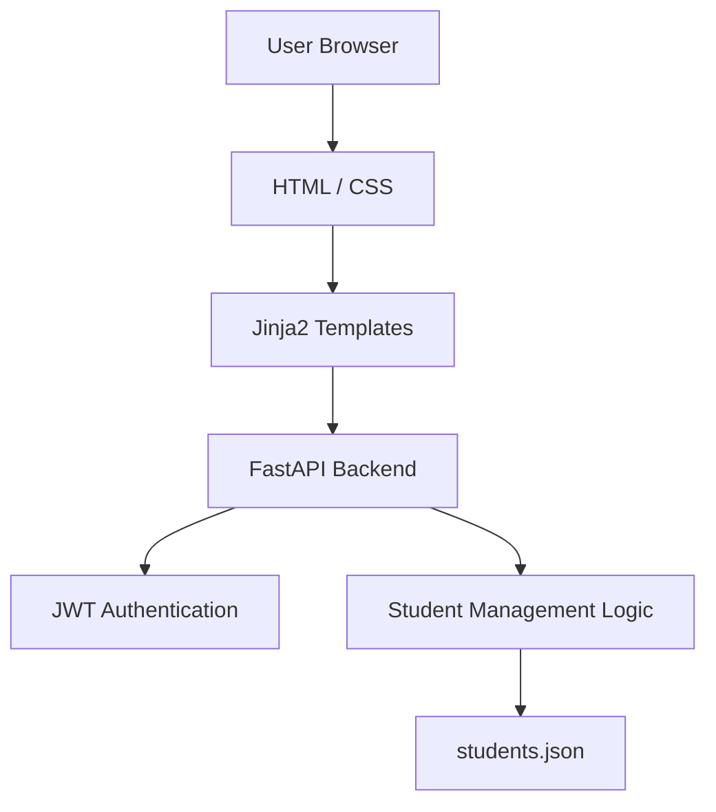

# Student Management System

A web-based Student Management System built with **FastAPI**, **Jinja2**, and **HTML/CSS**. It provides separate portals for students and administrators, with JSON-based student record storage.

## Features

### Student Portal
- Student login using registered name and roll number.
- JWT-based authentication stored in an HTTP-only cookie.
- Personal dashboard displaying the authenticated student's information.
- Students can access only the record associated with their login token.

### Admin Portal
- Separate administrator login using credentials configured in environment variables.
- Dashboard displaying student records and the total student count.
- Register new student records.
- Update existing student information.
- Delete student records after confirmation.

### Technical Features
- FastAPI routes and backend logic.
- Jinja2 server-side HTML templates.
- JWT authentication using PyJWT.
- JSON file storage.
- Environment configuration using `python-dotenv`.
- Static file support for CSS and other assets.

## Built With


## System Architecture



## Tech Stack

| Technology | Purpose |
|---|---|
| Python | Backend programming |
| FastAPI | Web framework and routing |
| Jinja2 | Server-side HTML templating |
| HTML & CSS | User interface |
| PyJWT | JWT creation and verification |
| JSON | Student record storage |
| python-dotenv | Environment variable loading |
| Pydantic | Data model definitions in `models.py` |

## Project Structure

```text
student-management-fastapi/
│
├── main.py
├── models.py
├── requirements.txt
├── students.json          # Create locally; do not commit private student data
├── .env                   # Create locally; never commit secrets
│
├── static/
│
└── templates/
    ├── home.html
    ├── login.html
    ├── students.html
    ├── admin_login.html
    └── admin_dashboard.html
```

The `students.json` and `.env` files should be created locally if they are not already present. Keep real student information and secret credentials out of public repositories.

## Installation and Setup

### 1. Clone the repository

```bash
git clone https://github.com/HafizHassanAlee/student-management-fastapi.git
cd student-management-fastapi
```

### 2. Create and activate a virtual environment

**Windows PowerShell:**

```powershell
python -m venv .venv
.venv\Scripts\Activate.ps1
```

**Linux / macOS:**

```bash
python3 -m venv .venv
source .venv/bin/activate
```

### 3. Install dependencies

```bash
pip install -r requirements.txt
```

### 4. Configure environment variables

Create a `.env` file in the project root:

```env
SECRET_KEY_ENV=your_long_random_secret_key
ALGORITHM_ENV=HS256
ACCESS_TOKEN_EXPIRE_MINUTES_ENV=30

ADMIN_USERNAME=admin
ADMIN_PASSWORD=change_this_password
```

Replace the example values with your own strong secret key and administrator password. Never upload your `.env` file to GitHub.

### 5. Create the student data file

Create `students.json` in the project root. The current application expects a JSON object whose keys are student CNICs:

```json
{
  "3520112345678": {
    "name": "Ali Khan",
    "age": 20,
    "gender": "Male",
    "city": "Lahore",
    "roll no": "Stf-501",
    "major": "Computer Science",
    "gpa": 3.7
  }
}
```

**Current student login:** The application checks the student's name as the username and roll number as the password.

### 6. Run the application

Using the FastAPI CLI:

```bash
fastapi dev main.py
```

Or using Uvicorn:

```bash
uvicorn main:app --reload
```

Open [http://127.0.0.1:8000](http://127.0.0.1:8000) in your browser.

## Application Routes

| Method | Route | Description |
|---|---|---|
| GET | `/` | Home page and portal selection |
| GET | `/login` | Student login page |
| POST | `/login` | Authenticate a student |
| GET | `/dashboard` | Student dashboard |
| GET | `/admin/login` | Admin login page |
| POST | `/admin/login` | Authenticate the administrator |
| GET | `/admin/dashboard` | Admin dashboard |
| POST | `/admin/students/create` | Register a student |
| POST | `/admin/students/update` | Update student information |
| POST | `/admin/students/delete` | Delete a student |

## Student Record Fields

Each student record currently contains:

- CNIC (used as the JSON record key)
- Name
- Age
- Gender
- City
- Roll number
- Major / department
- GPA

## Current Limitations and Next Steps

This is a learning project and currently uses a JSON file instead of a database. Planned improvements include:

- PostgreSQL database integration.
- SQLAlchemy ORM.
- Pydantic validation integrated into request handling.
- Individual student passwords with secure password hashing.
- Stronger authentication and authorization for every admin operation.
- Secure cookie settings for HTTPS deployment.
- Logout functionality.
- Automated tests and improved error handling.

**Development note:** The current update handler in `main.py` returns `HTMLResponse` for some errors, but `HTMLResponse` is not imported. Add `from fastapi.responses import HTMLResponse` before using those error responses. Also, protect the update route with the admin dependency, as the create and delete routes already are.

## Author

**Hassan Ali**

GitHub: [@HafizHassanAlee](https://github.com/HafizHassanAlee)

---

If you find this project useful, consider giving the repository a ⭐.
